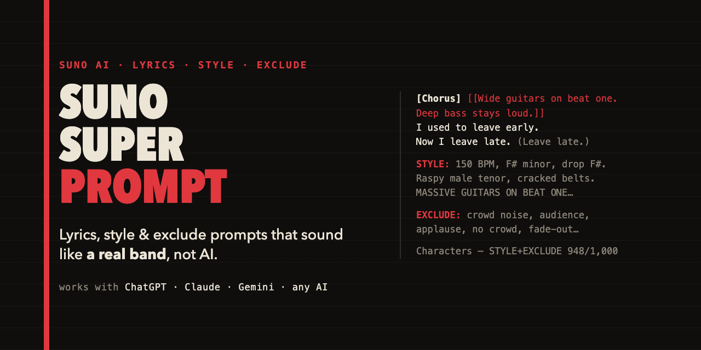

<div align="center">

[](https://jasonmello.github.io/suno-super-prompt/)

# Suno Super Prompt

**Suno AI prompts that sound like a real band, not AI.** Free, open-source SUPER PROMPT method for Suno lyrics, style and exclude, for ChatGPT, Claude, Gemini and any AI.

**Prompts para o Suno AI que soam como banda de verdade, não como IA.** Método gratuito e open source para letra, style e exclude no Suno, para ChatGPT, Claude, Gemini e qualquer IA.

**[Website](https://jasonmello.github.io/suno-super-prompt/)** · **[Quick start](#works-with-any-ai)** · **[Examples](skills/suno-super-prompt/examples)**

[](https://github.com/jasonmello/suno-super-prompt/actions/workflows/ci.yml)
[](LICENSE)
[](skills/suno-super-prompt/SKILL.md)
[](CONTRIBUTING.md)
[](#works-with-any-ai)

[English](#english) · [Português](#português)

</div>

---

## English

An open-source AI skill that turns any AI assistant (ChatGPT, Claude, Gemini, Grok, DeepSeek, Copilot…) into the **creative director and producer** of your band or project, in any genre (pop, rock, metal, hip-hop, R&B, electronic, country, sertanejo, funk, reggaeton…). It starts with a short conversation about the style you want, then writes complete Suno **SUPER PROMPTS** (title, lyrics with production directions, style and exclude), always within Suno's character limits.

It packages techniques learned across several albums, EPs and singles by a creator with **2+ years of intensive AI-music production** and **monetized releases on Spotify, Apple Music, YouTube Music** and other platforms ([about the creator](#about-the-creator)):

- A short **intake conversation** (style, references, voice, language, theme) before the first song.
- A **genre playbook** with BPM ranges, STYLE cores, vocal words and EXCLUDE guards for 20 genres.
- A lean **STYLE** structure Suno follows (BPM, key, riff, instrument roles, vocal cast, arrangement map).
- **EXCLUDE** blocks that stop crowd noise, slow intros, buried bass and theme sound effects.
- An **acoustic lock** for takes that are 100% voice and acoustic guitar.
- A **vocal cast** method so Suno respects singer order in feats and duets.
- **Lyric rules** against AI-core: one sung phrase per line, repeated hooks, banned vocabulary, singable choruses.
- A **validator** that fails any prompt over the limits and flags run-on lines, inline tags and hooks that never repeat.

### Quick look

```text
TITLE: KEEP THE GOOD PART

LYRICS:

[Verse 1]
[[One raspy male rock tenor, sharp chest-led singing over a relentless syncopated riff.]]
You picked the picture where I'm laughing.
Cut the argument out of frame.
Everybody says we looked so happy.
I know exactly what you'd say.

[Chorus]
[[Huge melodic hook over heavy open chords. Strong repeated rhythm on KEEP THE GOOD PART.]]
You can keep the good part.
I was there for all the rest.
You can tell them that you loved me.
You can leave out what came next.

[[Hard stop.]]

STYLE:
156 BPM. Four-bar bubblegum synth-pop fakeout in A major: glossy plucked SYNTH ...
Abrupt cut into A minor, seven-string drop-A metal ... Huge singable hook.

EXCLUDE:
crowd noise, audience, applause, crowd chants, no crowd, acoustic guitar, electric bass, ... fade-out.

Characters — LYRICS 4,104/5,000 · STYLE 736/1,000 · EXCLUDE 233/1,000 · STYLE+EXCLUDE 969/1,000
```

`[ ]` section · `[[ ]]` production direction · `( )` backing vocal · UPPERCASE line = shouted/screamed

### Works with any AI

The skill is plain text: rules, references and examples. Any assistant that accepts custom instructions or file attachments can use it: ChatGPT, Claude, Gemini, Grok, DeepSeek, Copilot, Le Chat, local models…

> **Creator's pick:** I use it every day, and my favourite for generating the songs is **ChatGPT**. That's where every album, EP and single behind these techniques was written. The other assistants work too, so use whichever you like best.

**ChatGPT (creator's choice)**

1. Create a **Project** (or a custom **GPT**).
2. Paste [`SKILL.md`](skills/suno-super-prompt/SKILL.md) into the instructions. Or paste the shorter [starter prompt](prompts/starter-prompt.md).
3. Upload the files from [`references/`](skills/suno-super-prompt/references) and [`examples/`](skills/suno-super-prompt/examples) as project files / knowledge.
4. Start with: *"Let's make a song"*. It asks what style you want and builds the first track with you.

ChatGPT can run `check_prompt.py` in its code tool when you upload it, which gives you exact character counts.

**Gemini, Grok, DeepSeek and others:** paste `SKILL.md` (or the starter prompt) at the start of the chat, or into a Gem / custom-instructions slot, and attach the references.

### Install (Claude)

**Claude Code: as a plugin**

```bash
/plugin marketplace add jasonmello/suno-super-prompt
/plugin install suno-super-prompt@suno-super-prompt
```

**Claude Code: manually**

```bash
git clone https://github.com/jasonmello/suno-super-prompt
cp -r suno-super-prompt/skills/suno-super-prompt ~/.claude/skills/
```

**Claude.ai / Claude desktop app**: download [`skills/suno-super-prompt`](skills/suno-super-prompt) as a `.zip` and upload it under *Settings → Capabilities → Skills*.

### Usage

Just ask:

> "Let's make a song." (it asks what style you want, then a few short questions)

> "Create a 5-track EP concept for my post-hardcore band. Raspy male vocalist. References: My Chemical Romance, Sum 41, Bad Omens."

> "A sertanejo single in Portuguese, male duo, about a guy who keeps going back to the same bar."

> "Next track."

> "Make the acoustic version of track 2: voice and guitar only."

> "Suno put an electric guitar in the acoustic take. Fix it."

### Character limits

| Field | Limit |
|---|---|
| TITLE | 80 |
| LYRICS (including `[ ]`, `[[ ]]`, `( )`) | 5,000 |
| STYLE | 1,000 |
| EXCLUDE | 1,000 |
| STYLE + EXCLUDE together | 1,000 |

Counts include spaces and line breaks. Every prompt ends with a count line, and the validator rejects anything over the limit:

```bash
python3 skills/suno-super-prompt/scripts/check_prompt.py my-prompt.txt --ban kitchen television
```

Limits can be changed with flags (`--style-limit`, `--exclude-limit`, `--combined-limit 0` …) if Suno changes them.

### Repository layout

```text
skills/suno-super-prompt/
├── SKILL.md                     # role, workflow, rules, limits, checklist
├── references/
│   ├── genre-playbook.md        # genre cards: BPM, STYLE core, vocals, guards
│   ├── super-prompt-format.md   # bracket grammar, layout, section vocabulary
│   ├── style-engineering.md     # how to write STYLE Suno obeys
│   ├── exclude-library.md       # EXCLUDE blocks by genre, voice, theme
│   ├── lyric-craft.md           # banned AI words, repetition, hooks, rhyme
│   ├── special-versions.md      # acoustic lock, feat/duet, remaster, cover
│   ├── album-workflow.md        # concept, tracklist, singles, bonus, cover art
│   ├── troubleshooting.md       # "Suno did X" → fix
│   └── release-ready.md         # artifact fixes, human production, honest credits
├── scripts/check_prompt.py      # validator (stdlib only)
└── examples/                    # complete prompts that worked
prompts/starter-prompt.md        # copy-paste prompt for other assistants
tests/                           # validator test suite
```

### FAQ

**Does it guarantee Suno will follow everything?** No. Suno is probabilistic. These techniques raise the hit rate a lot, especially the "say it three times" rule (section direction + UPPERCASE in STYLE + opposite in EXCLUDE). Regenerate when a take drifts.

**Why no artist names in STYLE?** Suno blocks or ignores them. The skill translates references into sonic descriptors.

**Can it write covers?** It writes the arrangement directions only. Paste your own licensed lyrics.

**Can it hide that a song was made with AI?** No. It won't help remove watermarks, alter metadata or misdeclare AI use: that risks takedowns and lost royalties. It helps you release properly instead: fix generation artifacts, re-record the parts that matter, and write honest credits. See [`release-ready.md`](skills/suno-super-prompt/references/release-ready.md).

---

## Português

Uma skill de IA open source que transforma qualquer assistente (ChatGPT, Claude, Gemini, Grok, DeepSeek, Copilot…) no **diretor criativo e produtor musical** da sua banda ou projeto, em qualquer gênero (pop, rock, metal, rap, R&B, eletrônica, sertanejo, funk, pagode, reggaeton…). Ela começa com uma conversa curta sobre o estilo que você quer e depois gera **SUPER PROMPTS** completos para o Suno (título, letra com direções de produção, style e exclude), sempre dentro dos limites de caracteres.

Reúne as técnicas usadas na criação de vários álbuns, EPs e singles por um criador com **mais de 2 anos de experiência intensa em produção musical com IA** e **músicas monetizadas no Spotify, Apple Music, YouTube Music** e outras plataformas ([sobre o criador](#sobre-o-criador)):

- Uma **conversa inicial** (estilo, referências, voz, idioma, tema) antes da primeira música.
- Um **guia de gêneros** com BPM, base de STYLE, voz e EXCLUDE para 20 gêneros.
- **STYLE** enxuto do jeito que o Suno obedece: BPM, tom, riff, papel de cada instrumento, elenco vocal e mapa do arranjo.
- Blocos de **EXCLUDE** contra público, intro lenta, baixo enterrado e efeitos sonoros do tema.
- **Trava acústica** para versões 100% voz e violão.
- Método de **elenco vocal** para o Suno respeitar a ordem dos cantores em feats e duetos.
- **Regras de letra** contra "AI-core": uma frase cantada por linha, ganchos repetidos, palavras proibidas, refrões cantáveis.
- **Validador** que reprova qualquer prompt acima dos limites.

### Funciona com qualquer IA

A skill é só texto: regras, referências e exemplos. Qualquer assistente que aceite instruções personalizadas ou anexos consegue usá-la, como ChatGPT, Claude, Gemini, Grok, DeepSeek, Copilot, Le Chat e modelos locais.

> **A preferência do criador:** eu uso no dia a dia, e o meu favorito para gerar as músicas é o **ChatGPT**. Foi nele que nasceram todos os álbuns, EPs e singles que deram origem a essas técnicas. As outras IAs também funcionam, então use a que você preferir.

**No ChatGPT (a escolha do criador):**

1. Crie um **Projeto** (ou um **GPT** personalizado).
2. Cole o [prompt inicial](prompts/starter-prompt.md) (em inglês) ou o [`SKILL.md`](skills/suno-super-prompt/SKILL.md) nas instruções.
3. Envie os arquivos de [`references/`](skills/suno-super-prompt/references) e [`examples/`](skills/suno-super-prompt/examples) como arquivos do projeto.
4. Comece com: *"Vamos criar uma música"*. Ela pergunta o estilo que você quer e monta a primeira faixa com você.

Se você também enviar o `check_prompt.py`, o ChatGPT pode rodá-lo na ferramenta de código e conferir a contagem exata de caracteres.

**Gemini, Grok, DeepSeek e outras:** cole o prompt inicial (ou o `SKILL.md`) no começo da conversa, num Gem ou nas instruções personalizadas, e anexe as referências.

### Instalação no Claude

**Claude Code (plugin):**

```bash
/plugin marketplace add jasonmello/suno-super-prompt
/plugin install suno-super-prompt@suno-super-prompt
```

**Claude Code (manual):** copie `skills/suno-super-prompt` para `~/.claude/skills/`.

**Claude.ai / app do Claude:** compacte a pasta `skills/suno-super-prompt` em `.zip` e envie em *Settings → Capabilities → Skills*.

### Como usar

> "Vamos criar uma música." (ela pergunta o estilo e faz algumas perguntas curtas)

> "Crie o conceito de um EP de 5 faixas para minha banda de post-hardcore. Vocal masculino rouco. Referências: My Chemical Romance, Sum 41, Bad Omens."

> "Próxima faixa."

> "Faça a versão acústica da faixa 2, só voz e violão."

> "O Suno colocou guitarra elétrica na versão acústica. Corrija."

### Limites de caracteres

TITLE **80** · LYRICS **5.000** · STYLE **1.000** · EXCLUDE **1.000** · STYLE + EXCLUDE juntos **1.000**. Os limites contam espaços e quebras de linha. Todo prompt termina com a linha de contagem, e o `check_prompt.py` reprova qualquer campo acima do limite.

### As 8 regras de ouro

1. **Nada de "AI-core"**: sem neon, static, velvet, echoes, shadows, beneath. Use cenas concretas, objetos e diálogos.
2. **O EXCLUDE sempre começa com** `crowd noise, audience, applause, crowd chants, no crowd`.
3. **Varie a arquitetura**: nem toda música precisa ser Intro/Verse/Chorus.
4. **Refrões cantáveis**, com o último refrão mudando uma linha.
5. **Toda seção tem uma `[[direção]]`.**
6. **Fale três vezes**: nas `[[ ]]`, no STYLE em MAIÚSCULAS e o oposto no EXCLUDE.
7. **Sem nomes de artistas no STYLE.**
8. **Exclua o som literal do tema**, como tiros numa música de guerra.

---

## About the creator

**Jason Mello** ([@jasonmello](https://github.com/jasonmello)) has over **two years of intensive, hands-on work** producing music with AI. His releases are **monetized and distributed on Spotify, Apple Music, YouTube Music** and other streaming platforms.

Every rule in this skill comes from that practice: the fixes that made Suno obey, and the lyric standards that kept songs from sounding machine-made. ChatGPT is his day-to-day tool for writing the songs, and the skill is built to work with any AI.

## Sobre o criador

**Jason Mello** ([@jasonmello](https://github.com/jasonmello)) tem **mais de dois anos de experiência intensa** produzindo música com IA. Suas músicas são **monetizadas e distribuídas no Spotify, Apple Music, YouTube Music** e outras plataformas de streaming.

Cada regra desta skill vem dessa prática: as correções que fizeram o Suno obedecer e o padrão de letra que evita músicas com cara de máquina. O ChatGPT é a ferramenta do dia a dia dele para escrever as músicas, e a skill foi feita para funcionar com qualquer IA.

---

## Contributing / Contribuindo

Found a STYLE phrase or EXCLUDE trick that Suno respects? See [CONTRIBUTING.md](CONTRIBUTING.md) and open an issue or PR. Mention the Suno model version you tested.

## License

[Apache 2.0](LICENSE) © Jason Mello. See [NOTICE](NOTICE). This is an independent community project, not affiliated with or endorsed by Suno, Inc. Example lyrics are original works from the author's projects.
